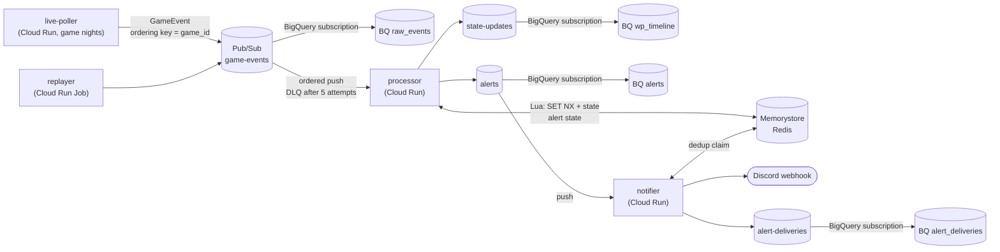

# ClutchWatch

A real-time NBA pipeline on Google Cloud that watches every live game and posts to Discord when one becomes worth switching to:

> 🏀 BOS @ IND: tied (127-127), 2:51 left in OT. Close game late.

Python 3.12 · Pub/Sub · Cloud Run · Memorystore (Redis) · BigQuery · Terraform · GitHub Actions (Workload Identity Federation).

## Architecture



- **Ingest.** Live NBA CDN play-by-play (`nba_api.live`) and historical play-by-play ([shufinskiy/nba_data](https://github.com/shufinskiy/nba_data), archived in the same CDN format) go through one normalizer into one `GameEvent` schema, so nothing downstream knows the source.
- **Processor.** Applies each event to per-game state with one Redis Lua script (duplicate check + state update, atomic), computes home win probability, evaluates alert rules.
- **Win probability.** Logistic regression on margin and time left, trained offline on 2020-21 to 2022-23; coefficients ship as JSON, no ML dependencies at runtime.
- **Alerts.** `CLOSE_LATE`, `WP_SWING`, `COMEBACK`, max 4 per game, deduped in Redis across restarts; the notifier dedups again on `alert_id` before posting.

Every design choice, with the alternatives and the measurement behind it, is in [docs/DECISIONS.md](docs/DECISIONS.md).

## Results

All numbers are from runs on GCP; commands and BigQuery queries are in [RESULTS.md](RESULTS.md) and [bench/queries/](bench/queries/). Load runs replay the full 2024-25 season (1,230 games, 686,008 events) from a Cloud Run Job, so both timestamps come from Google's clocks.

| | Target | Measured | |
|---|---|---|---|
| T1 throughput | ≥ 1,000 ev/s for 10 min | every full-season run kept up (e.g. 686,008 events in 686 s, 999.5 ev/s processed) | ✅ |
| T2 latency, publish → state | p50 < 150 ms, p99 < 1 s | push, 5 runs: p50 85-1,328 ms, p99 7-15 s; StreamingPull tried twice, slower; processor itself 23 ms | ❌ time is inside Pub/Sub before delivery |
| T3 alert → Discord | p95 < 2 s | p95 914 ms at real game pace ×30 | ✅ + stretch |
| T4 event loss | 0 | 0 lost in 8 full-season runs (5.5M events); DLQ empty | ✅ |
| T5 duplicates, 10% forced redelivery | 0 double-applied | 68,797 redeliveries, 0 double-applied, 1,230/1,230 final scores exact | ✅ |
| T6 redeploy mid-replay | no loss, correct state | 0 lost, no throughput gap, latency normal ~70 s later | ✅ |
| T7 model | beat baselines, calibrated ≤ 0.05 | Brier 0.161 vs 0.250 on the held-out 2025-26 season; max decile error 0.023 | ✅ + stretch |
| T8 alert recall | ≥ 90% of games ≤ 3 pts or OT | 210 / 210 on held-out 2025-26 | ✅ + stretch |
| T9 alert spam | ≤ 5% of blowouts; ≤ 1.5/game | 3.6% of blowouts, 0.97/game on held-out 2025-26 | ✅ |
| T11 deploy | one script, < 10 min | 6 min 49 s from torn-down | ✅ + stretch |

Model trained on 2020-21..2022-23; model selection and alert tuning on 2023-24; tests on 2024-25 and 2025-26 (the latter never used for any choice). The spec's original alert rules on 2023-24: 76% recall, 43% of blowouts alerted, 2.16/game.

## Run it

Prerequisites: a GCP project with billing and a budget alert, `gcloud`, Terraform ≥ 1.9, `uv`.

```bash
uv sync && uv run pytest                     # tests (no GCP needed)
./scripts/fetch_data.sh                      # historical play-by-play -> data/
./scripts/deploy.sh                          # terraform + image build + release
TF_EXTRA_VARS="-var live_poller=true" ./scripts/deploy.sh   # game night: poll live games
bench/run_load.sh load1 1000                 # full-season replay at 1,000 ev/s
./scripts/teardown.sh redis                  # stop the one idle-billing resource, keep BigQuery
./scripts/teardown.sh                        # remove everything
```

The Discord webhook lives in Secret Manager: `pbpaste | gcloud secrets versions add discord-webhook --data-file=-`.

Model: `uv run --group model python -m model.train && uv run --group model python -m model.evaluate`. Alert tuning: `uv run python -m bench.tune_alerts`.

## Layout

```
ingest/      normalize.py (GameEvent + one normalizer), replayer.py, live_poller.py, publisher.py
processor/   app.py (push endpoint), state.py (Redis Lua apply), winprob.py, alerts.py, wp_model.json
notifier/    app.py (Discord, dedup, delivery records)
model/       train.py, evaluate.py, calibration plot
infra/       Terraform: Pub/Sub, BigQuery, Redis, Cloud Run, IAM, WIF
bench/       run_load.sh, run_restart.sh, check_state.py, tune_alerts.py, queries/*.sql
scripts/     deploy.sh, release.sh, teardown.sh, fetch_data.sh
docs/        DECISIONS.md
```
