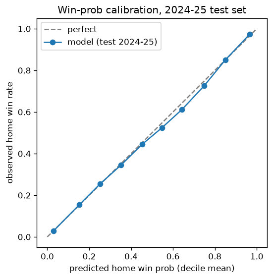

# Results

Every number here comes from a command that was actually run; the command (and, for
pipeline metrics, the BigQuery query in `bench/queries/`) is listed with it.

## T7: Model quality

Command (2026-11-12):

```
uv run --group model python -m model.train      # train 2020-21..2022-23, export processor/wp_model.json
uv run --group model python -m model.evaluate   # val 2023-24, test 2024-25, saves the plot
```

Logistic regression on `[margin, minutes_left, margin / sqrt(seconds_left + 1)]`, one row per
scoring event. Trained on 415,765 scoring events from 3,540 games (2020-21 to 2022-23).

| Split | Scoring events | Games | Brier (model) | Brier (constant 0.5) | Brier (leader wins) | Max per-decile calibration error |
|---|---|---|---|---|---|---|
| val 2023-24 | 145,642 | 1,230 | 0.1614 | 0.2500 | 0.2420 | 0.0438 |
| **test 2024-25** | 144,139 | 1,230 | **0.1641** | 0.2500 | 0.2497 | **0.0310** |

Target met: test Brier beats both baselines, every decile within 0.05. Stretch (Brier ≤ 0.18) met.



Caveats worth saying out loud: rows within a game are correlated, so the effective sample size
is closer to the 1,230 test games than to 144K events; and calibration is reported per decile of
predicted probability pooled over all game states, not per game phase. The weakest band is
0.6-0.7 (predicted 0.643, observed 0.612).
